# Suya Night

**A hands-only, seated VR cooking story from Lagos.** Fan the charcoal, grill the skewers, shake
the yaji, wrap it in yesterday's newspaper and hand it over — with your bare hands, in the Meta
Quest Browser, straight from a link.

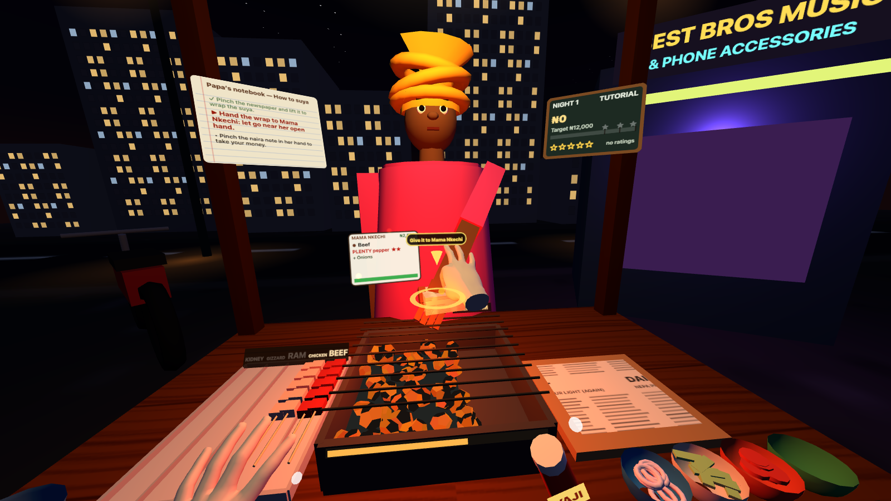

> Entry for the **Meta VR Start Developer Competition 2026** — Gaming track, New Experience division.
> **Play:** [nkimajie.github.io/suya-night](https://nkimajie.github.io/suya-night/) · **Video:** `[YouTube link]`

| | |
|---|---|
| **Input** | Hand tracking first. Every step — menus, story, cooking, serving, pause, retry — works with bare hands. Controllers (trigger = pinch) and a desktop mouse also work. |
| **Comfort** | Seated and stationary. Everything you touch is within about 60 cm of your head (an automated test checks it). No turning around, no reaching to the floor. |
| **Session** | Cold start to the first cooking action in about 40 seconds. One night is about 5 minutes. Taking the headset off pauses. |
| **Content** | 8 playable nights in 2 acts, 10 named characters, Pidgin dialogue, a stall that grows as you play. |
| **Tech** | three.js + WebXR, plain JavaScript, ~240 KB gzipped. Every model, texture and sound is generated in code (the only binary assets are the two hand-tracking meshes, the app icon and the link preview). |

---

## The story

Mallam Sani has run the most famous suya spot on Allen Avenue, Ikeja, for thirty years. This
afternoon he collapsed by his grill. Tonight his son **Aminu — you —** runs the stall alone, and the
landlord, **Chief Adebayo**, gives you **three nights** to prove it can make money before he hands the
space to the Gbam Burger people.

- **Act 1 — Mallam Sani's Corner (Nights 1–3).** Mama Nkechi, Papa's oldest customer, teaches you
  the job. Friday brings the rush and a NEPA blackout. On Night 3 the landlord comes to taste, and the
  quiet man in the black cap who has been watching all along finally orders.
- **Act 2 — The Spot Grows (Nights 4–8).** A new lease and a new sign: *MALLAM SANI & SON*. Spend
  your savings on the stall, turn regulars into family, survive a driver rush and a long blackout,
  and face a fast-food chain opening a "Suya Burger" shop across the road. It ends on a cliffhanger:
  Mama Nkechi's daughter is getting married, and you're catering the owambe.

| Character | Who they are |
|---|---|
| Mama Nkechi | Papa's oldest customer, your Night 1 teacher. Always "plenty pepper". |
| Chief Adebayo | The landlord. Hard, funny, and slowly won over. |
| Tolu | A cab driver who is always in a hurry. Later sends the OyaGo drivers your way. |
| Corper Fatima | A youth corps member from Kano who misses home cooking. |
| Big Boss Emeka | Big orders, big tips, "no pepper for madam". |
| Uncle Femi | Buys suya "for a friend". The friend is him. |
| The man in the black cap | Watching from Night 1. Who is he? |
| Gbam Burger manager | The rival, tasting the competition. |
| Mallam Sani | Papa. |

## How to play

Each night, customers walk up, say their order out loud (speech bubble + order card), and wait.
You cook it with your hands:

| Step | Gesture |
|---|---|
| Keep the fire hot | Pinch the woven fan (abebe) and wave it fast over the grill. The coals glow, embers fly and fat flares up under the meat. |
| Take meat | Pinch a stick in the tray (beef, ram, chicken, gizzard, kidney). |
| Grill and turn | Lay it on the grill. To turn it: pinch, lift, put it back. The gauge under each stick goes green when that side is golden and flashes red before it burns. |
| Park it | Cooked early? Put it on the KEEP WARM end. |
| Plate it | Drop the stick on the newspaper. |
| Yaji pepper | Pinch the shaker and shake it over the paper: 1–5 shakes = normal, 6+ = PLENTY. |
| Sides | Pinch onions, cabbage, tomatoes or masa from a bowl and drop them on the paper. |
| Wrap | Pinch the newspaper and lift. |
| Serve | Let go of the wrap near the customer's open hand. |
| Get paid | Pinch the naira note — or the phone with the CREDIT ALERT — in their hand. |
| Lagos handshake | Mama Nkechi (after your first order) and regulars who become friends or family hold out a hand: pull back, slap palms, then pinch as the hands part — the snap. Just for fun; it never blocks play. |
| Menus | Poke a button with a fingertip, or pinch it. |
| Pause | Poke **Pause** on the counter edge. Taking the headset off also pauses. |

A soft ring shows what each hand will grab if you pinch right now, so you never have to guess
depth. On Night 1 a gold arrow and a short label sit on the next thing to touch, and Papa's notebook
holds the full sentence.

The street is alive: customers blink and their mouths move while they talk, a perfect order gets a
cheer and a wave, meat hissing onto the grill throws steam, and each yaji shake puffs a little red cloud.

Customers rate every order out of 5 stars: right meats, cooked golden (not raw, not burnt), the
pepper they asked for, the right sides. Fast, perfect orders earn tips; 4★+ in a row builds a
**combo**. Wait too long and they walk away.

## Grow the business

| | |
|---|---|
| **Stars per night** | ★ hit the target · ★★ 125% · ★★★ 150% with a 4★ average rating. Replay any night from the map. |
| **Savings** | "Rent first, the rest na your own": only money *above* the target goes into Papa's savings tin (starts at ₦5,000). |
| **Shop** | Six upgrades, and every one appears on your stall (the game points at it when you buy it). |
| **Regulars** | Serve a named regular 4★+ twice → FRIEND ♥ (more patience, bigger tips, new line). Five times → FAMILY ♥♥. |
| **Every day** | Papa's Special: one meat pays +₦500 a stick, picked from today's date. |
| **Lagos life** | Bank-transfer customers (sometimes the alert is "pending"…), NEPA blackouts, a driver rush, a rival chain. |

| Upgrade | Price | What it does |
|---|---|---|
| Tip tin | ₦4,000 | Customers tip 15% more |
| Canopy lights | ₦5,000 | Customers wait 20% longer |
| Hardwood charcoal | ₦6,000 | Meat cooks 15% faster, coals glow brighter |
| Big abebe fan | ₦7,000 | Fanning 50% stronger, the fire dies 30% slower |
| Papa's yaji blend | ₦9,000 | +10% on every order |
| Generator | ₦12,000 | When NEPA takes the light, the gen starts in a few seconds |

| Night | Title | What's new |
|---|---|---|
| 1 | The First Night | Tutorial with Mama Nkechi. Beef and chicken. The clock waits until you finish it. |
| 2 | Friday Rush | All five meats, masa, two customers at once, and a NEPA blackout. |
| 3 | The Inspection | The landlord tastes. Keep your rating 3.5★+. The black cap orders. |
| 4 | New Lease | Act 2: savings, shop, regulars, bank transfers. |
| 5 | Driver Rush | A wave of OyaGo drivers in a hurry (they tip well). |
| 6 | Light Off Again | A long blackout. The generator earns its price. |
| 7 | Across the Road | Gbam Burger opens a "Suya Burger" shop opposite. Their manager comes to taste. |
| 8 | The Review | Dayo the food blogger returns. Everybody you know comes tonight. |

The map shows Stage 3, *Owambe Contract*, as coming next, and lists the road after it.

**Short on time?** Settings → **Open all nights** unlocks every night on the map and adds ₦30,000
to the savings tin, so you can jump straight to Act 2 and the shop.

## Screenshots

All captured in Meta's Quest 3 emulator (IWER) from the seated eye, with tracked-hand models.

| | |
|---|---|
| 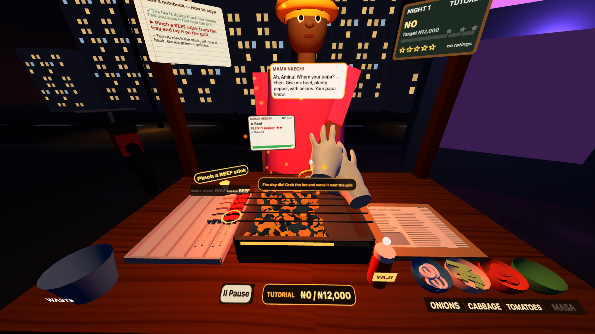 Fan the coals | 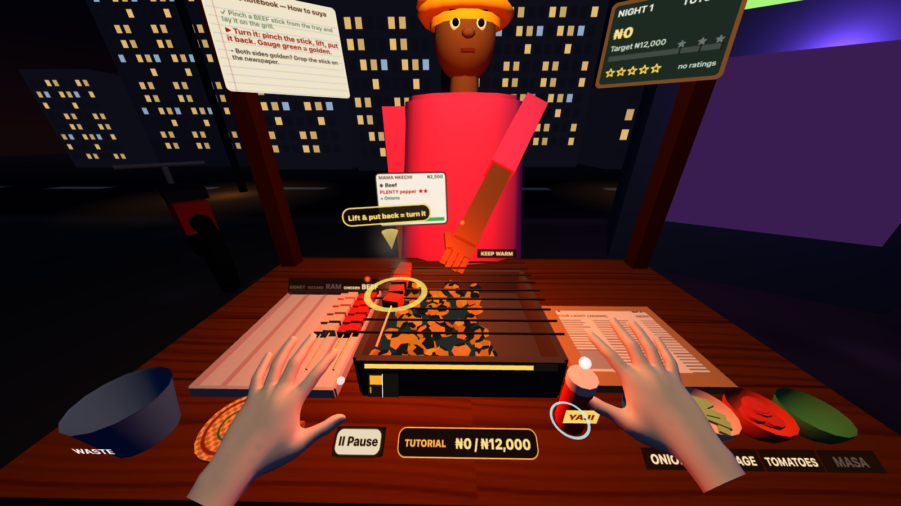 Grill and turn |
| 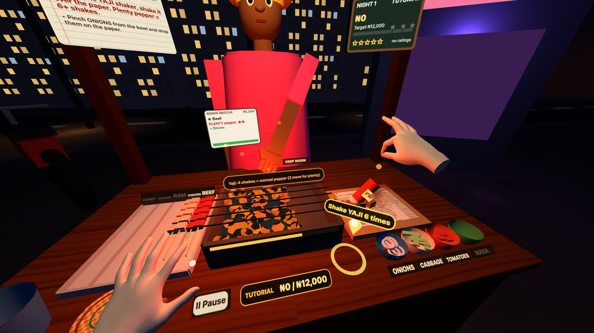 Shake the yaji | 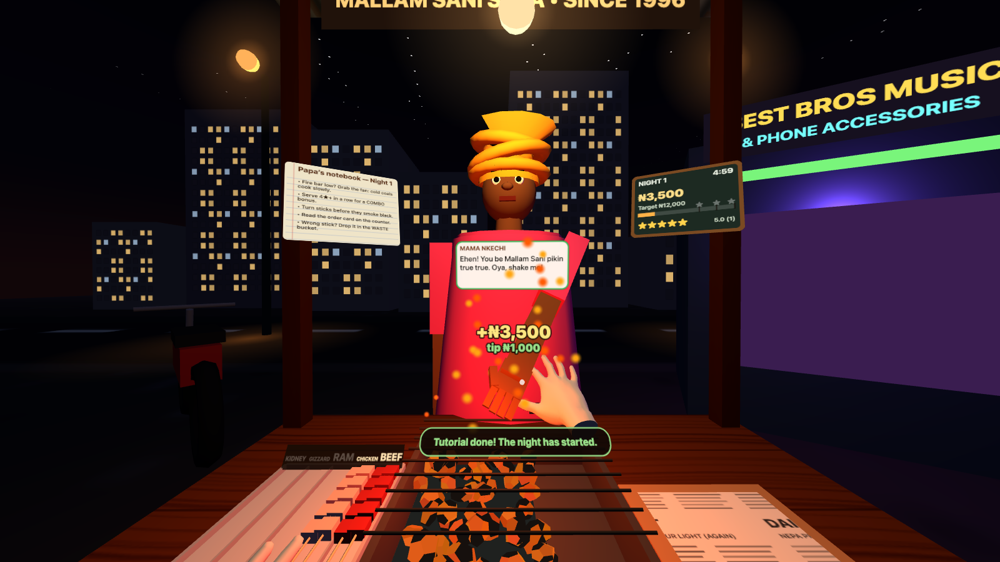 Get paid |
| 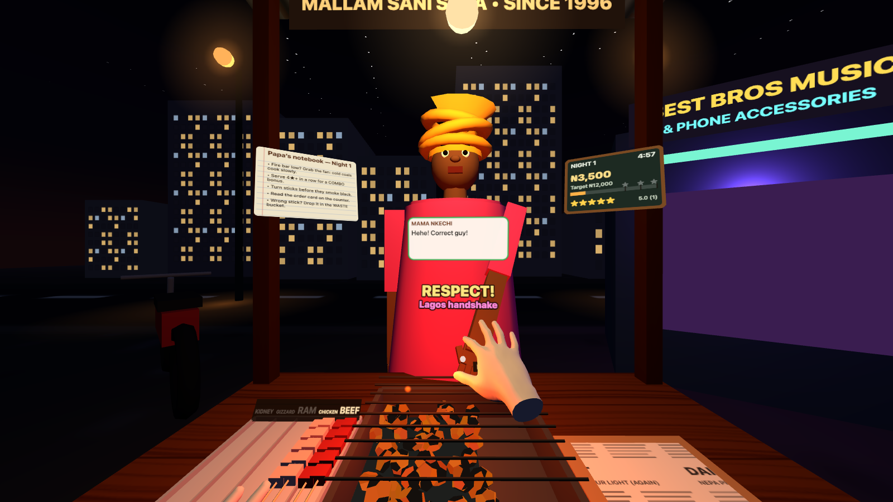 Mama Nkechi's Lagos handshake: slap, then snap | 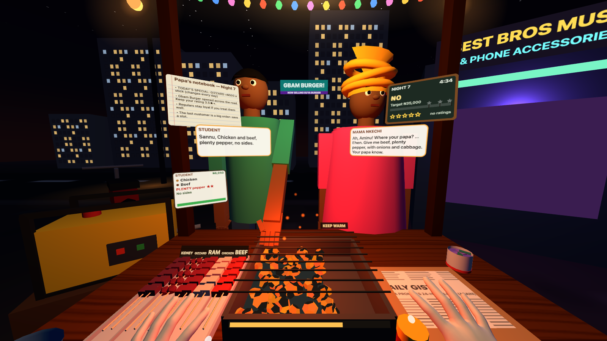 Every upgrade on the stall, the rival across the road |
| 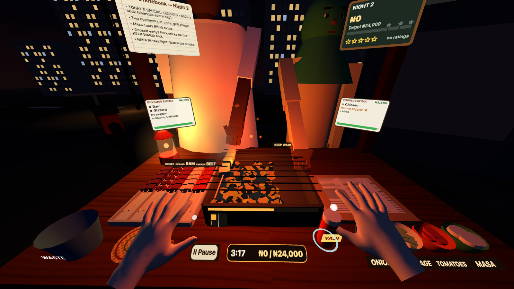 NEPA takes the light | 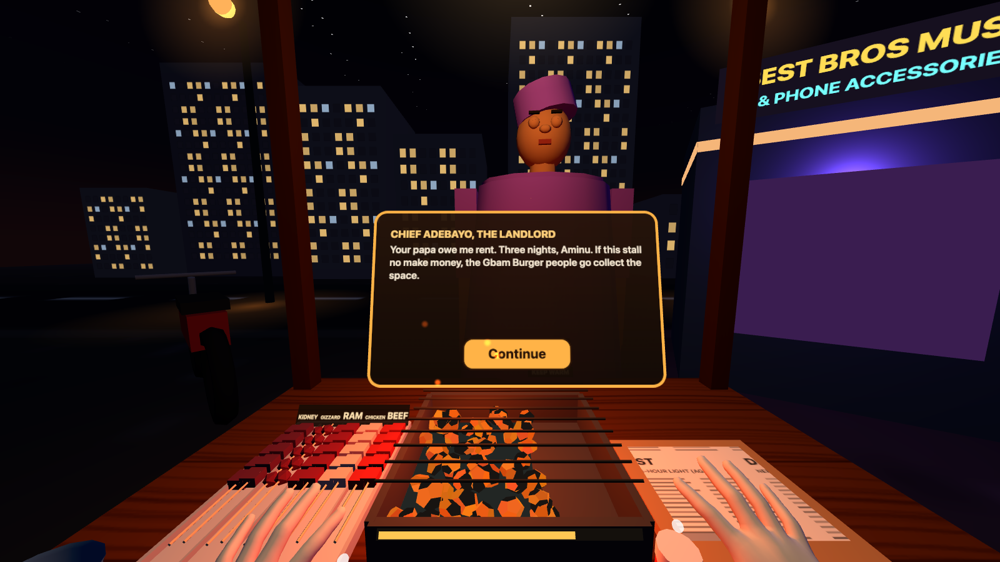 The landlord's ultimatum |
| 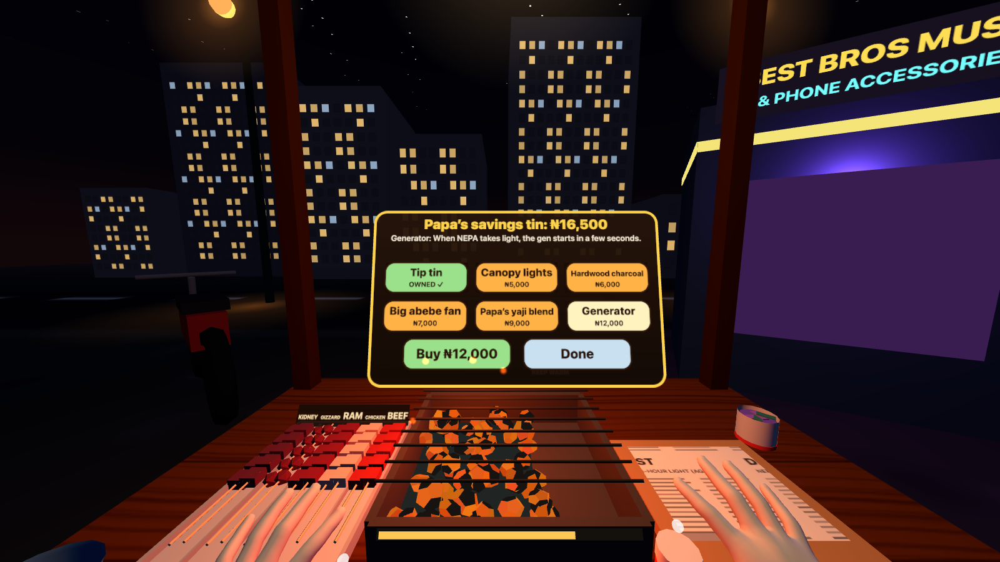 Papa's savings tin | 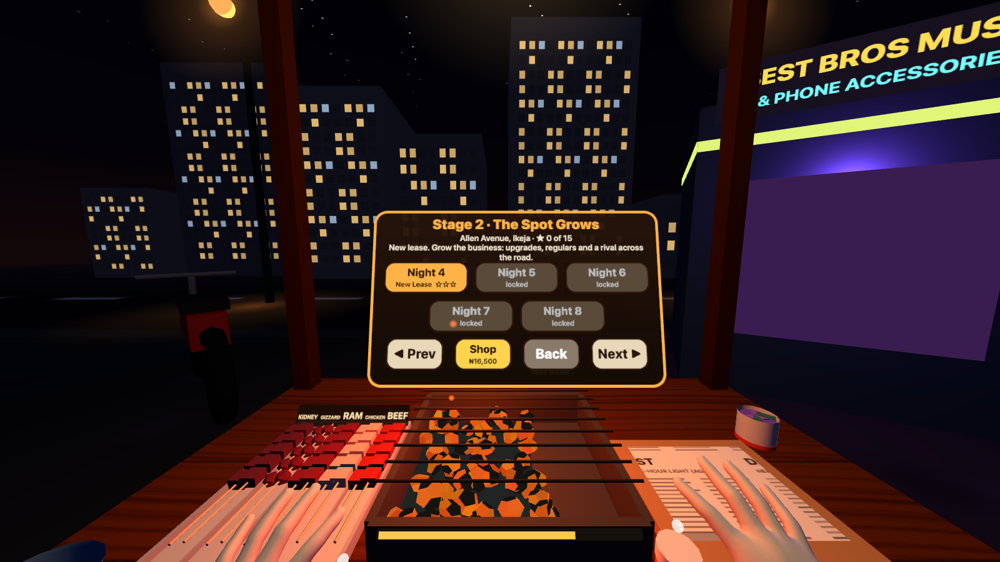 The road ahead |
| 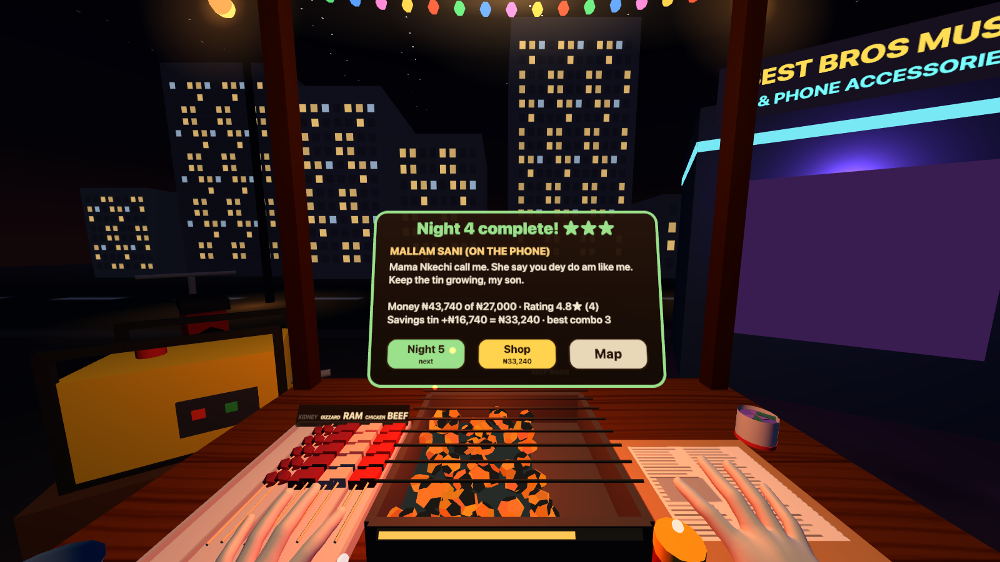 Stars and savings | 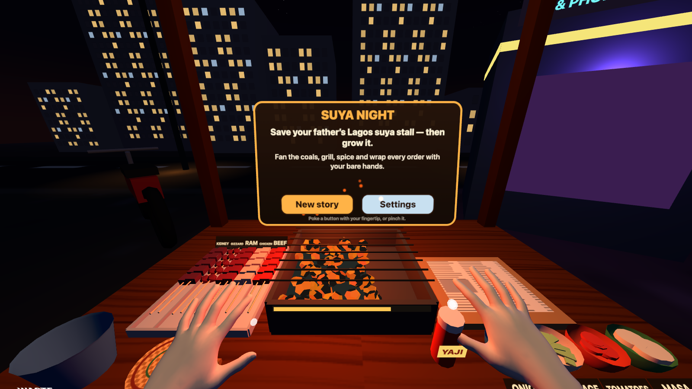 Poke to start — hands only |

Devpost gallery versions (3:2, captioned) are in [docs/gallery/](docs/gallery/).

## Built for the competition guidelines

- **Hands only, end to end.** Pinch to grab, wave to fan, shake to season, lift to wrap, hand-to-hand
  to serve, poke for menus. If tracking is lost or declined, an in-headset card explains how to fix it.
- **Seated, two-foot radius.** Everything interactable is within ~0.6 m of the head, below eye level.
  `npm test` fails if anything drifts out of reach.
- **Narrow field of view.** Time and money sit on the counter lip, right under your eyes while you
  cook; order cards sit on the counter in front of each customer; tutorial labels sit on the object.
- **Quick in, quick out.** Two story cards, then the first action — fanning a dying fire — within
  seconds. Pause on headset removal or system menu; resume where you left off.
- **Comfortable and readable.** No locomotion, no snap turns, a fixed horizon, large canvas text,
  voices off by default (speech bubbles always show), Story mode with relaxed timers.
- **Accessible.** Settings has **One-hand play** (the fire tends itself, so every step needs only one
  hand) and **Counter height** (lower / normal / higher, for different chairs, wheelchairs and arm
  reach). Doneness is shown by bar length, a white "golden" mark, flashing and a warning sound, not by
  colour alone.
- **Original content.** Every character, place, brand and sign is invented. No real companies or people.

## Run it

```bash
npm install
npm run dev          # desktop preview: http://localhost:5173 (click = pinch)
npm run dev:quest    # HTTPS on your LAN: open https://<your-computer-ip>:5173 in the Quest Browser
npm run build        # production build in dist/
npm test             # headless Chrome: full tutorial order, nights 2-8, shop, reach, memory, emulated hands
npm run shots        # regenerate docs/screenshots, docs/gallery and the link preview
```

URL options (dev server):

| Option | What it does |
|---|---|
| `?emulate=1` | Meta's IWER Quest 3 emulator with tracked hands, in a normal desktop browser. Click **Enter VR**. |
| `?emulate=1&demo=1` | The game plays itself with emulated hands (fan, grill, turn, yaji, sides, wrap, serve, get paid). Add `&night=2` to start on another night. Used to record the trailer without a headset. |
| `?demo=1` | Same autopilot with the desktop pointer (works on the deployed build too). |
| `?cam=head` | Desktop view from the seated eye. |
| `?cam=street&demo=1` | Slow camera sweep along the street side of the stall: B-roll. |
| `?clean=1` | Hide the page's info card (for screen captures). |

`npm run dev:quest` uses a self-signed certificate: in the Quest Browser choose *Advanced → Proceed*.

## How it's built

```
index.html          landing card + Enter VR button (no framework)
src/main.js         renderer, WebXR session (immersive-vr + hand-tracking), recentering, frame loop, demo/camera modes
src/input.js        hands / controllers / mouse  →  one Pointer API: pos, tip, pinching, pinchStarted, vel, candidates()
src/kitchen.js      grill + coals, skewers + cooking, tray, newspaper, yaji shake detection, sides, wrapping, aim rings
src/customers.js    procedural people (merged per body part), speech bubbles, order cards, patience, cash / transfer
src/game.js         state machine: menu → story → night → results → shop / map; tutorial, scoring, loyalty, events, pause
src/levels.js       stages and nights: tuning, scripted arrivals, events, tips, star rules
src/story.js        characters and all dialogue
src/upgrades.js     shop items, loyalty tiers
src/save.js         versioned localStorage save (v2) with migration from v1
src/ui.js           poke/pinch buttons, story board, chalkboard HUD, Papa's notebook, highlight arrow
src/env.js          night street, stall, lights, NEPA blackout, upgrade props, rival sign
src/audio.js        procedural Web Audio: ambience, Afrobeats-style loop, sizzle, SFX, optional speech
src/demo.js         autopilot for trailer footage (drives IWER hands or the desktop pointer)
src/fx.js           pooled particles (smoke, embers, flare-ups, pepper, coins)
src/text.js         canvas-texture panels and text fitting
```

- **One input path.** Gameplay never reads hands, controllers or the mouse directly — only the
  `Pointer` API. So the desktop tests and the autopilot exercise exactly the code the hands use.
  Real pinches drift a few centimetres while the fingers close, so grabs first try the point where the
  fingers were last clearly open (`Pointer.candidates()`).
- **Gestures.** Fanning reads the held fan's speed over the grill; shaking counts direction reversals
  of the hand holding the shaker (with a slow "pour" fallback for anyone whose shakes don't register);
  wrapping is a lift of the pinched paper; serving checks release distance to each customer's hand.
- **Procedural everything.** People, stall, street, signs, newspaper and woven fan textures are drawn
  in code; the music, sizzle, generator hum and every effect are Web Audio. No art pipeline, tiny download.
- **Performance budget (Quest 2/3 browser, 72 Hz).** ≤ 4 lights, no real-time shadows, about 95–120 draw calls
  per eye in a busy scene (merged static meshes, instanced burn gauges, vertex-coloured people),
  pooled particles, canvas textures redrawn only when their content changes, everything a customer
  owns freed when they leave (a test checks memory stays flat over 24 customers).
- **Frame-rate safety net.** If the headset runs slower than about 64 fps for a few seconds, the game
  steps down once or twice: stronger fixed foveation, then half the particles and no street glows.
  It never steps back up, so it cannot oscillate.
- **Saves** are local and versioned; nothing goes to a server.

## Tests

`npm test` runs two headless-Chrome suites and fails on any console error:

- `tests/smoke.mjs` — plays the whole Night 1 tutorial order through the scripted pointer, checks
  fanning, cooking, flipping, yaji, sides, wrap, serve and payment; the Night 2 blackout; Night 3
  results; shop, map, stars, savings, generator, loyalty, Act 1 → Act 2; save migration; draw-call and
  light budgets; seated reach of every interactable; GPU memory over 24 customers; pause regressions.
- `tests/xr.mjs` — enters VR in Meta's IWER Quest 3 emulator and uses emulated hand joints to grab,
  place, fan and poke shop tiles, steps the frame-rate safety net down; then lets the demo autopilot play
  the tutorial order end to end, including Mama Nkechi's handshake (slap + snap).

## Deploy

GitHub Pages via `.github/workflows/deploy.yml` (builds `dist/` on every push to `main`):

1. Create a public GitHub repo and push `main`.
2. Settings → Pages → Source: **GitHub Actions**.
3. The workflow run shows the site URL. Open it in the Quest Browser and tap **Enter VR (hands)**.

After the competition deadline, remove the `push:` trigger in the workflow so the judged build
cannot change. See [docs/LAUNCH_CHECKLIST.md](docs/LAUNCH_CHECKLIST.md) and
[docs/SUBMISSION.md](docs/SUBMISSION.md).

## Credits and licenses

Game code, story, characters and generated art/audio: © 2026 the Suya Night team. All rights reserved
(see [LICENSE](LICENSE)). Third-party software: [THIRD_PARTY_NOTICES.md](THIRD_PARTY_NOTICES.md).
